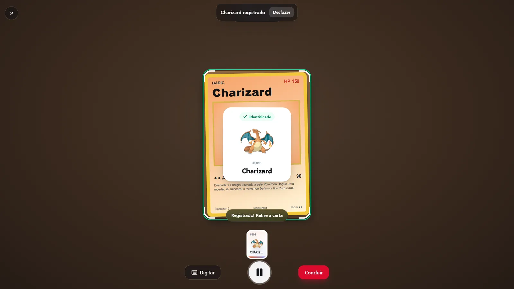
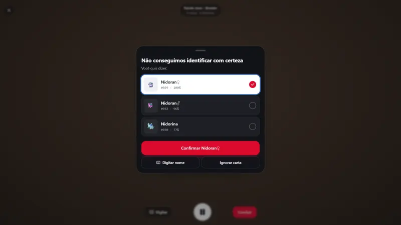
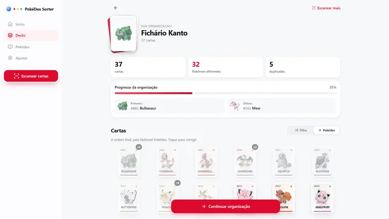
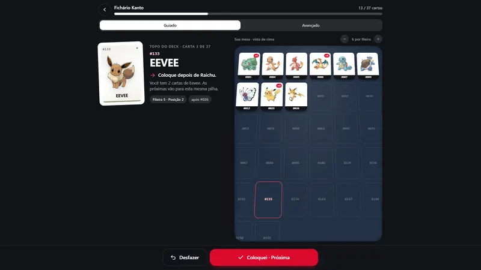
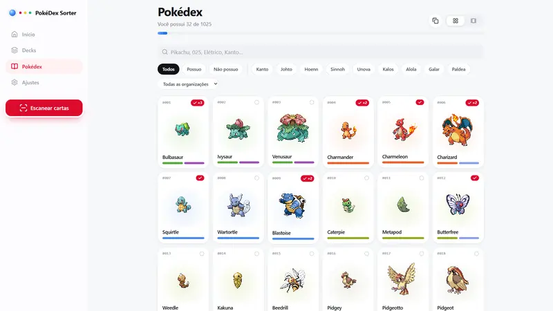

# Organizador de Cartas Pokémon com Leitura por Câmera (OCR)

A câmera lê as cartas e guia a organização física pela National Pokédex.

<p align="center">
  
</p>

> **Demo:** https://pokemon-card-organizer.vercel.app

---

## Sumário

- [Visão geral](#visão-geral)
- [Telas](#telas)
- [Fluxo](#fluxo)
- [Arquitetura](#arquitetura)
- [Stack e versões](#stack-e-versões)
- [Estrutura do projeto](#estrutura-do-projeto)
- [Primeiros passos](#primeiros-passos)
- [Scripts](#scripts)
- [Deploy](#deploy)
- [Autor](#autor)

---

## Visão geral

Organiza cartas Pokémon físicas na ordem da National Pokédex. A câmera do celular lê as cartas por OCR, compara o nome com a PokeAPI por correspondência aproximada (fuzzy matching), conta cada carta uma única vez e sugere opções quando a leitura tem dúvida. Mostra resumo (cartas, Pokémon diferentes, duplicadas) e guia a organização física ("coloque depois de Charizard", fileira e posição), com modo de arrastar e soltar. Sem backend: dados salvos no aparelho.

Principais funcionalidades:

- OCR contínuo com Tesseract.js direto no navegador
- Fuzzy matching contra a PokeAPI
- Sugestões quando a leitura é ambígua
- Organização guiada e modo arrastar e soltar
- Funciona offline com IndexedDB

Concluído em 10/2026.

---

## Telas

Todas as telas usam dados fictícios.

<table>
  <tr>
    <td width="50%"><br><sub>Sugestões de confirmação para leitura ambígua</sub></td>
    <td width="50%"><br><sub>Resumo da coleção com cartas e duplicadas</sub></td>
  </tr>
  <tr>
    <td width="50%"><br><sub>Organização guiada na mesa</sub></td>
    <td width="50%"><br><sub>Pokédex interativa</sub></td>
  </tr>
</table>

---

## Fluxo

1. **Nova organização** → abre o scanner contínuo.
2. **Scanner**: a câmera fica aberta; cada carta é lida por OCR (Tesseract), o texto passa por
   fuzzy matching contra os nomes da PokéAPI e a carta é registrada. A mesma carta não é contada
   duas vezes: o scanner trava na carta atual e só libera quando ela sai do quadro.
   Baixa confiança → folha de confirmação com sugestões.
3. **Resumo**: cartas, Pokémon diferentes, duplicadas, primeiro/último, correção manual.
4. **Organizar**: modo guiado ("Coloque depois de Charizard", fileira/posição na mesa) e modo
   avançado (sequência completa + "Conferir mesa" com drag & drop via Shopify Draggable).
5. **Concluído**.

---

## Arquitetura

- `src/services/pokeApiService.ts` — índice da National Pokédex (gerações + tipos, cache em IndexedDB) e detalhes.
- `src/services/ocrService.ts` — `OcrEngine` (Tesseract.js, carregado sob demanda).
- `src/services/pokemonRecognitionService.ts` — `PokemonRecognitionService` desacoplado do OCR.
- `src/services/pokemonMatcher.ts` — normalização + distância de edição ponderada (caracteres confundíveis no OCR).
- `src/services/sortingService.ts` — agrupamento de duplicatas, ordenação, instruções físicas, cartas fora de ordem.
- `src/hooks/useContinuousScanner.ts` — máquina de estados do scanner e trava por carta.
- `src/store/*` — Zustand com persistência local.

---

## Stack e versões

| Categoria | Tecnologia | Versão |
| --- | --- | --- |
| Linguagem | TypeScript | 6.0 |
| UI | React | 19.2 |
| Build | Vite | 8.3 |
| Rotas | React Router | 7.18 |
| Estilo | Tailwind CSS | 4.3 |
| Dados | TanStack Query | 5.104 |
| Estado | Zustand | 5.0 |
| OCR | Tesseract.js | 7.0 |
| Interação | Shopify Draggable | 1.2 |
| Animação | Motion | 14.0 |
| Persistência | IndexedDB | 6.3 |

As versões exatas estão no `package.json`.

---

## Estrutura do projeto

```
src/
  components/
    layout/
    pokemon/
    scanner/
    sorting/
    ui/
  hooks/
    useCamera.ts
    useContinuousScanner.ts
    usePokemonData.ts
  lib/
    format.ts
  pages/
    CompletedPage.tsx
    HomePage.tsx
    OrganizationSummaryPage.tsx
    OrganizationsPage.tsx
    PokedexDetailPage.tsx
    PokedexPage.tsx
    … (+3)
  services/
    frameService.ts
    ocrService.ts
    pokeApiService.ts
    pokemonMatcher.ts
    pokemonRecognitionService.ts
    sortingService.ts
    … (+1)
  store/
    organizationsStore.ts
    settingsStore.ts
    toastStore.ts
    uiStore.ts
  types/
    index.ts
  App.tsx
  index.css
  main.tsx
```

---

## Primeiros passos

### Pré-requisitos

- Node.js 20.19 ou mais recente
- npm

### Instalação

```bash
git clone https://github.com/marcospsdev/pokemon-card-organizer.git
cd pokemon-card-organizer
npm install
npm run dev               # http://localhost:5173
```

---

## Scripts

| Comando | Descrição |
| --- | --- |
| `npm run dev` | Servidor de desenvolvimento (Vite) |
| `npm run build` | Typecheck e build de produção em `dist/` |
| `npm run lint` | Analisa o código com o ESLint |
| `npm run preview` | Serve o build de produção localmente |
| `npm run dev:https` | Servidor de desenvolvimento com HTTPS (para testar a câmera no celular) |
| `npm run typecheck` | Checagem de tipos do TypeScript |

---

## Deploy

Versão publicada: https://pokemon-card-organizer.vercel.app

1. Importe o repositório na [Vercel](https://vercel.com) (o Vite é detectado automaticamente).
2. Build: `npm run build` · saída: `dist`.
3. Cadastre as variáveis de ambiente em **Settings → Environment Variables** (se houver) e faça o deploy.

O `vercel.json` redireciona todas as rotas para o `index.html`, então as rotas do React funcionam ao recarregar a página.

---

## Autor

**Marcos Paulo** · Desenvolvedor Full-Stack

- LinkedIn: [in/marcospsdev](https://www.linkedin.com/in/marcospsdev)
- GitHub: [@marcospsdev](https://github.com/marcospsdev)
